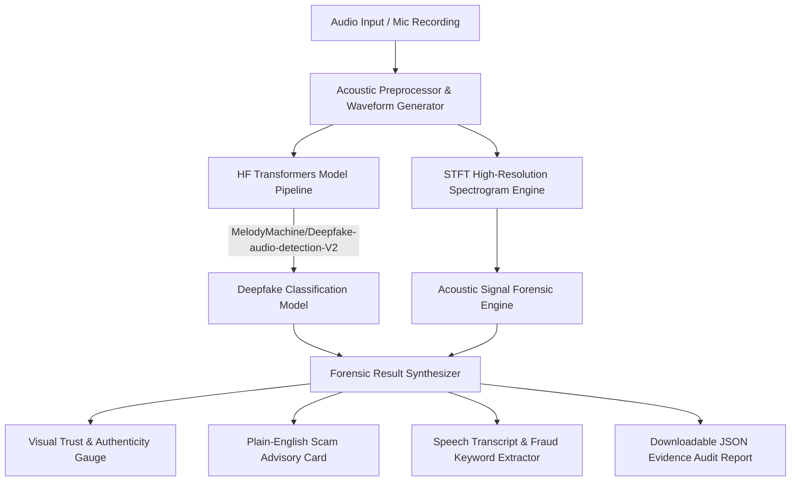

# 🛡️ VocalTrace: Real-Time Synthetic Audio & Voice Scam Detector

> **Deepfake forensics and acoustic artifact analysis to combat AI voice-impersonation fraud.**
> Built for hackathons, cybersecurity operations, and digital trust verification.

---

## 🎯 Target Persona & Cybersecurity Vibe
VocalTrace is designed as a **cybersecurity intelligence dashboard** for end-users, financial fraud prevention teams, and hackathon judges to verify the authenticity of incoming call recordings, voicemails, and audio messages in real time. 

Featuring a sleek dark cybersecurity theme (slate `#0d1117`, cyan/emerald safe indicators `#00f2fe`/`#10b981`, and amber/crimson threat alerts `#f59e0b`/`#ef4444`), VocalTrace turns complex signal processing into instant, actionable safety intelligence.

---

## 🚀 Alignment with UN Sustainable Development Goals (SDGs)
- **🛡️ SDG 16: Peace, Justice & Strong Institutions** — Protects vulnerable individuals (e.g. elderly grandparents, family members) from AI voice cloning extortion, emergency wire scams, and synthetic voice fraud.
- **🔐 SDG 9: Digital Trust & Infrastructure** — Builds resilient digital communication networks by deploying AI forensic analysis to verify synthetic vs. authentic speech.

---

## 🌟 Key Features & Architecture



1. **Header & Context Bar:**
   - Real-time threat classification badges, SDG badges, and model status indicators.
2. **Interactive Audio Visualizer (Split View - Left Column):**
   - HTML5 audio playback engine.
   - Dual Matplotlib charts: **Acoustic Waveform** (Amplitude vs. Time) and **High-Resolution Spectrogram Heatmap** (Frequency vs. Time).
   - Automatically highlights neural vocoder high-frequency brickwall cutoffs (>7.8 kHz).
3. **Forensic Scan Results (Split View - Right Column):**
   - **Big Visual Trust & Authenticity Gauge:** Instant status display (`✅ Human Voice Verified Authentic` vs `⚠️ AI Synthetic Voice Detected`).
   - **Plain-English Scam Advisory Card:** Explains technical forensic findings in human-readable terms with actionable safety instructions.
   - **Confidence Meter Breakdown:** Probability bars for Natural Human Speech vs Synthetic Voice Clone.
   - **Micro-Acoustic Artifact Meters:** Vocoder Phase Anomaly, High-Frequency Cutoff, Pitch Jitter Consistency, and Room Noise Floor Continuity.
   - **Transcript & Fraud Intent Keyword Analyzer:** Flags emergency extortion phrases (e.g., *wire transfer, car crash, bail money, do not call mom*).
4. **1-Click Hackathon Quick Demo Presets:**
   - **🟢 Sample A:** Authentic Human Voice
   - **🔴 Sample B:** AI Voice Clone / Emergency Wire Scam
   - **🟠 Sample C:** Grandparent Emergency Bail Scam

---

## 📦 Technical Implementation Stack

- **Frontend Interface:** Streamlit (Python) with custom cybersecurity CSS layout & Matplotlib visualizers.
- **AI Model Pipeline:** Python with `transformers` using pre-trained audio classification model `MelodyMachine/Deepfake-audio-detection-V2` via Hugging Face pipeline.
- **Acoustic Signal Processing:** `librosa`, `matplotlib`, `soundfile`, `scipy`, `numpy`.
- **Robust Fallback Engine:** Features a fallback heuristic signal processing engine if offline or API limits are reached during live hackathon demos.

---

## 🛠️ Quickstart Guide

### 1. Prerequisites
- Python 3.9 or higher

### 2. Installation
Clone or navigate to the repository directory and install the requirements:

```bash
# Optional: Create and activate virtual environment
python -m venv venv
# On Windows:
venv\Scripts\activate
# On Linux/macOS:
source venv/bin/activate

# Install required dependencies
pip install -r requirements.txt
```

### 3. Generate Audio Demo Samples
Run the built-in sample audio generator script to prepare test WAV files:

```bash
python sample_generator.py
```

### 4. Launch the Web Application
Start the VocalTrace Streamlit web application:

```bash
streamlit run app.py
```

Open your browser at `http://localhost:8501` to test the application!

---

## 📄 License
Developed for Hackathon & Open Digital Trust Research. MIT License.
